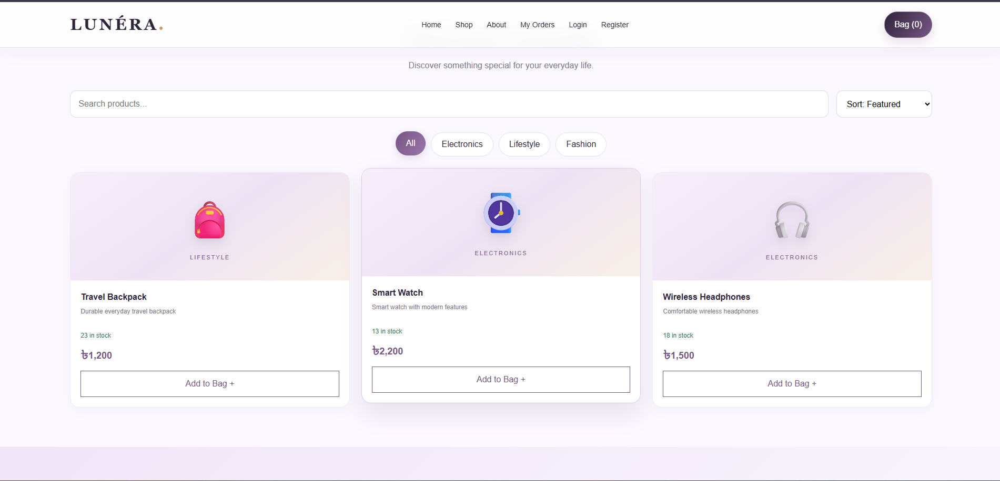
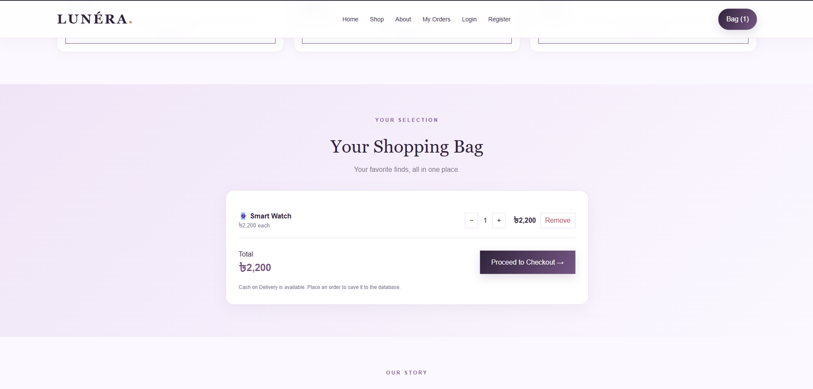

# LUNÉRA – E-Commerce Website

LUNÉRA is a full-stack e-commerce web application built using modern web technologies.

## Features

- Customer Registration and Login
- Product Browsing
- Product Search and Filtering
- Shopping Bag Management
- Checkout and Order Placement
- Order History
- Admin Dashboard
- Product and Inventory Management
- Low Stock Alerts

## Technologies Used

- HTML5
- CSS3
- JavaScript
- Node.js
- Express.js
- MySQL

## Installation

1. Clone the repository:

   git clone https://github.com/misha-akter/LUNERA-Ecommerce.git

2. Navigate to the project folder:

   cd LUNERA-Ecommerce

3. Install dependencies:

   npm install

4. Configure your environment variables in `.env`.

5. Start the application:

   npm run dev

6. Open http://localhost:3000

## Project

LUNÉRA – Full-Stack E-Commerce Website

---

## Project Screenshots

### 1. Homepage
.png)

### 2. Product Listing

### 3. Shopping Bag

### 4. Checkout & Order Section

### 5. Admin Dashboard

### 6. Order Management

### 7. Products & Stock Management

---
